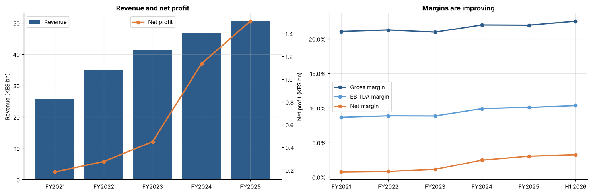

# Quickmart IPO Valuation: Is It Worth Buying at KES 7.50?

**Tools:** Python, pandas, NumPy, matplotlib, Jupyter

An independent valuation of Quick Mart PLC, Kenya's second largest supermarket chain, ahead of its Nairobi Securities Exchange listing on 12 November 2026.

## The question
Quickmart's private equity owner, Adenia, is selling 50% of the company to the public at **KES 7.50 per share**, a **KES 30 billion** valuation. This project asks: does the business justify that price, and what growth would an investor need to believe in for KES 7.50 to be fair?

## Key findings



**The business is strong**
* Revenue grew **18.4% a year**, from KES 25.7bn (2021) to KES 50.4bn (2025)
* Net margin improved from **0.7% to 3.2%**, and the business converts profit into cash
* Kenya's number two supermarket, with about 15% market share and almost no bank debt

**The price is full**

| Measure at KES 7.50 | Value |
|---|---|
| P/E on FY2025 actual profit | 19.9x |
| P/E on H1 2026 profit x 2 | 17.2x |
| P/E on FY2026 adjusted forecast (headline figure) | 12.9x |
| Price to book | 15.6x |
| Forecast dividend yield | 6.7% (91 day T-bill: 8.76%) |
| Profit growth needed in FY2026 | 39% |

**Two stage dividend discount model** (required return 16.5%)

| Scenario | Dividend growth, years 1 to 5 | Fair value | vs KES 7.50 |
|---|---|---|---|
| Bear | 5% | KES 4.35 | 42% below |
| Base | 12% | **KES 5.69** | **24% below** |
| Bull | 18% | KES 7.29 | 3% below |

At a 16.5% required return, KES 7.50 implies dividends growing about **22% a year for five years**, faster than Quickmart's revenue growth since 2021.

**Cash paid out:** from FY2023 to H1 2026, Quickmart earned KES 3.97bn and paid KES 4.71bn to its owner (119% of profit), including a KES 1.1bn shareholder advance before the IPO. The company receives none of the IPO proceeds.

## Conclusion: Neutral
A good, growing business priced for strong growth. The offer suits investors seeking dividend income who believe double digit growth will continue. On valuation alone it is not cheap. The view would change with a share price below about KES 6, or FY2026 results confirming the forecast profit jump.

## Method
1. Financial data entered from the information memorandum (FY2021 to H1 2026)
2. Growth, margin and cash flow analysis
3. Dividend and payout analysis
4. Valuation multiples at the offer price
5. Two stage dividend discount model with bear, base and bull scenarios
6. Sensitivity grid across required returns and growth rates
7. Reverse valuation: the growth rate implied by KES 7.50

## Data and assumptions
* **Source:** Quick Mart PLC Information Memorandum, October 2026 (audited FY2021 to FY2025, unaudited H1 2026). Figures are entered by hand from the memorandum's selected historical financial information and offer statistics.
* **Required return:** CAPM with a 11.3% risk free rate (Kenya 10 year bond), 6.5% equity risk premium and an assumed beta of 0.8. Fair value is sensitive to this choice; see the sensitivity grid in the notebook.
* **Dividend growth** is assumed to track profit growth, given the stated payout policy of at least 80% of profit.
* **91 day T-bill rate:** Central Bank of Kenya auction results, October 2026.

## Limitations
* Based only on the information memorandum and my own assumptions
* No peer comparison, as Kenya's largest competitors (Naivas, Carrefour) are not listed
* FY2026 figures are company forecasts, not actual results

## How to run
```
pip install -r requirements.txt
jupyter notebook quickmart_ipo_analysis.ipynb
```
No data files are needed; all figures are in the notebook.

## Disclaimer
This is a personal analysis for learning purposes, not investment advice. Speak to a licensed stockbroker or financial adviser before investing.
